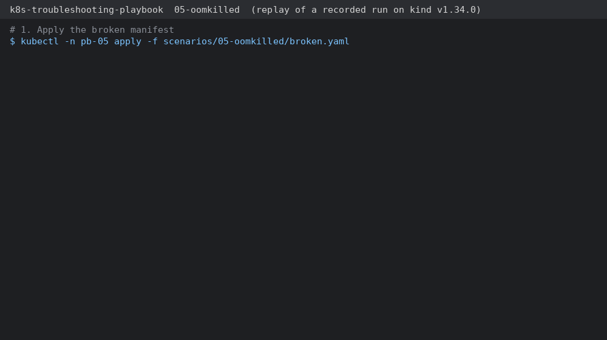
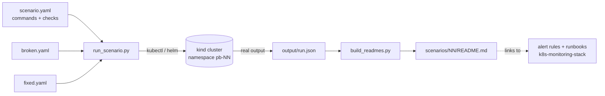
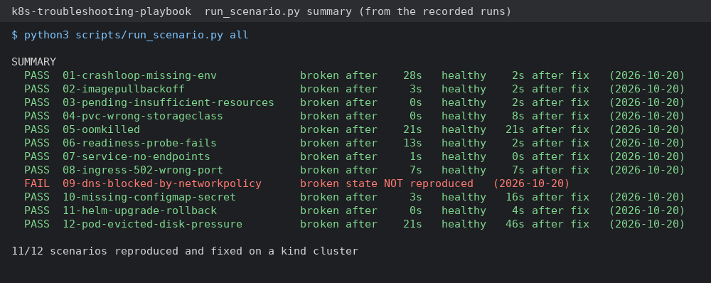

# k8s-troubleshooting-playbook

**Twelve common Kubernetes failures you can break, diagnose and fix on a local cluster. 11 of them are verified on kind, with the real `kubectl` output.**

Each scenario has a broken manifest you apply to a test cluster, the symptoms you will see, the diagnosis commands in the order I run them (with real output), the root cause, the fix (as a diff), and how to prevent it, including the alert rule from [k8s-monitoring-stack](https://github.com/paulZYF/k8s-monitoring-stack) that would catch it.

11 of the 12 scenarios were run end to end on a kind cluster by `scripts/run_scenario.py`; the output in each of those write-ups comes from that run, nothing was typed in by hand. Scenario 09 (NetworkPolicy blocks DNS) could not be reproduced on my test machine and is marked **not verified** (see [Limits](#limits)).



## How to use it

1. Create a test cluster (one command, see below).
2. Apply one `broken.yaml` into its own namespace.
3. Try to find the problem yourself.
4. Compare with the write-up, then apply `fixed.yaml`.

Or run the whole thing automatically and get a pass/fail summary:

```bash
python3 scripts/run_scenario.py all      # or: python3 scripts/run_scenario.py 05
```

## Architecture



For each scenario the runner creates the namespace `pb-NN`, applies the broken manifest, waits until the failure is really visible (for example the pod reports `CrashLoopBackOff`), runs the diagnosis commands, applies the fix, waits until the workload is healthy, runs the checks and saves everything. Then it deletes the namespace.

## Setup

Requirements: Docker, [kind](https://kind.sigs.k8s.io), kubectl, Helm (scenario 11), Python 3.10+ with PyYAML (and Pillow only to re-render the docs images).

```bash
./scripts/kind-up.sh            # one-node kind cluster "playbook"
pip install pyyaml
python3 scripts/run_scenario.py all
python3 scripts/build_readmes.py   # rebuild the write-ups from your own run
```

Offline checks (no cluster): `./scripts/validate.sh` runs yamllint, kubeconform on every `broken.yaml` / `fixed.yaml`, `helm lint` + kubeconform for the scenario 11 chart, and a structure check of every `scenario.yaml`.

Scenario 08 installs ingress-nginx (`scripts/install-ingress-nginx.sh`, the upstream "baremetal" manifest with a NodePort Service) the first time it runs. The test client talks to the controller through its ClusterIP Service, so no host ports are needed.

To re-render the GIF and the summary image from your own run: `pip install pillow && python3 scripts/render_docs.py`.

## Scenario index

<!-- INDEX -->
| # | Scenario | Root cause (short) | Verified on kind |
|---|---|---|---|
| [01](scenarios/01-crashloop-missing-env/README.md) | CrashLoopBackOff: app exits because a required env var is missing | The container exits with code 1 at start because `DATABASE_URL` is not set. | yes |
| [02](scenarios/02-imagepullbackoff/README.md) | ImagePullBackOff: wrong image tag | The tag `nginx:1.27.99-alpine` does not exist in the registry, so the kubelet gets "not found" and backs off. | yes |
| [03](scenarios/03-pending-insufficient-resources/README.md) | Pending: not enough CPU / memory on any node | The pod requests 64 CPUs and 256 GiB memory. | yes |
| [04](scenarios/04-pvc-wrong-storageclass/README.md) | Pending: PersistentVolumeClaim not bound (wrong StorageClass) | The PVC asks for `storageClassName: fast-ssd`, which does not exist in this cluster, so no provisioner ever creates a volume and the PVC stays Pending. | yes |
| [05](scenarios/05-oomkilled/README.md) | OOMKilled: memory limit too low | The worker needs about 150 MiB but the container limit is 64 MiB. | yes |
| [06](scenarios/06-readiness-probe-fails/README.md) | Readiness probe fails: pod is Running but gets no traffic | The readiness probe calls `/healthz`, which nginx does not serve (404). | yes |
| [07](scenarios/07-service-no-endpoints/README.md) | Service has no endpoints: label selector does not match the pods | The Service selects `app=web-frontend`, but the pods are labelled `app=frontend`. | yes |
| [08](scenarios/08-ingress-502-wrong-port/README.md) | Ingress returns 502: Service targetPort does not match the container port | Ingress → Service → Pod each have their own port. | yes |
| [09](scenarios/09-dns-blocked-by-networkpolicy/README.md) | DNS lookup fails inside the cluster: NetworkPolicy blocks CoreDNS | An egress NetworkPolicy selects every pod in the namespace and only allows TCP/80 to pods in the same namespace. | no |
| [10](scenarios/10-missing-configmap-secret/README.md) | Missing ConfigMap / Secret: pod stuck in CreateContainerConfigError | The container reads `MODE` from ConfigMap `notifier-config` and `SMTP_PASSWORD` from Secret `notifier-smtp`. | yes |
| [11](scenarios/11-helm-upgrade-rollback/README.md) | Helm upgrade fails: roll back first, then fix the values | The upgrade changed the image tag to `1.28-alpne` (typo). | yes |
| [12](scenarios/12-pod-evicted-disk-pressure/README.md) | Pods evicted: ephemeral storage (disk) limit exceeded | The container writes a new 20 MB file every 2 seconds and never deletes old ones. | yes |
<!-- /INDEX -->

## My general diagnosis order

I go through the same short list every time, from the outside in:

1. **get**: `kubectl get pods -o wide`. Look at STATUS, READY, RESTARTS and the node.
2. **describe**: `kubectl describe pod <pod>`. Read the *Events* at the bottom and *Last State / Reason / Exit Code*.
3. **logs**: `kubectl logs <pod> --previous`. When it crashed, the previous container has the error. No logs at all usually means the container never started (scenarios 02, 03, 04, 10).
4. **events**: `kubectl get events --sort-by=.lastTimestamp`. This is where scheduling, volume and eviction problems show up.
5. **config**: check the objects the pod depends on: ConfigMap/Secret (10), PVC/StorageClass (04), image/tag (02), requests/limits (03, 05, 12).
6. **service path**: `kubectl get endpointslices` → Service selector/targetPort → Ingress (06, 07, 08).
7. **node**: `kubectl describe node`. Look at conditions (DiskPressure, MemoryPressure), allocated resources and taints.
8. **network**: DNS from inside the pod's namespace (`nslookup`), then NetworkPolicies (09).

| Exit code / reason | Usually means |
|---|---|
| `Exit Code 1` | the app failed at start: config, env, dependency (01) |
| `Exit Code 137` + `OOMKilled` | memory limit too low (05) |
| `CreateContainerConfigError` | missing ConfigMap / Secret / key (10) |
| `ImagePullBackOff` + `not found` | wrong image or tag (02) |
| `Pending` + `FailedScheduling` | requests too big, PVC unbound, taints/affinity (03, 04) |
| `Running` but `0/1` READY | readiness probe fails (06) |
| `Evicted` | node or ephemeral-storage pressure (12) |

## Alert rules that catch these failures

From [k8s-monitoring-stack](https://github.com/paulZYF/k8s-monitoring-stack) (`alerts/`), each with a runbook page:

| Alert | Scenarios |
|---|---|
| `PodCrashLooping` | 01, 05 |
| `PodOOMKilled` | 05 |
| `PodImagePullFailing` | 02, 11 |
| `PodNotReady` | 03, 04, 10 |
| `DeploymentReplicasMismatch` | 06, 10, 11 |
| `AppHighErrorRate` | 08, 09 |
| `NodeDiskAlmostFull`, `KubeNodeNotReady` | 12 (the node-disk variant only; no rule here alerts on one pod hitting its own `ephemeral-storage` limit, as shown in the demo) |

Scenario 07 (no endpoints) is not caught by a pod-level rule because the pods are healthy. You need a blackbox probe on the Service URL for that.

How this mapping was checked: each rule has promtool unit tests in k8s-monitoring-stack, and `PodCrashLooping`, `PodOOMKilled`, `PodImagePullFailing`, `PodNotReady` and `DeploymentReplicasMismatch` fired on that repo's kind demo for the same kinds of broken workloads. The runner here does not install Prometheus, so the alerts were not observed while running these exact scenarios. `AppHighErrorRate` only works if the app or the ingress controller exports request metrics.

## Screenshots

- `docs/demo.gif`: scenario 05 (OOMKilled) from broken to fixed. It is a replay of the commands and output that `run_scenario.py` recorded (rendered by `scripts/render_docs.py`), not a screen recording.
- `docs/summary.png`: pass/fail for every scenario, rendered from the recorded runs.



## Limits

- Tested on a single-node kind cluster (kind v0.30, Kubernetes v1.34). Things like real node failure or cloud load balancers behave differently in a real cluster.
- Scenario 09 is **not verified**. kind's default CNI (kindnet) enforces NetworkPolicy through the kernel's nfqueue, and the kernel of my test machine did not have it, so the deny-all egress policy had no effect and DNS kept working. The manifests are standard NetworkPolicy and should behave as described on a CNI that enforces policies (Calico, Cilium), but I did not run that.
- Scenario 05: on this setup the container status sometimes says `Reason: Error` instead of `OOMKilled` (both with exit code 137) when the container dies right after start. The runner therefore checks for exit code 137; the write-up explains how to read it.
- Scenario 12 shows evictions from an `ephemeral-storage` limit. It does not fill the node's real disk, because on a shared machine that would break other workloads. The DiskPressure path is described in the write-up but was not reproduced.
- "Time to fix" in each write-up is the time from applying the fix to healthy. It does not include diagnosis time.

## License

MIT, see [LICENSE](LICENSE).
